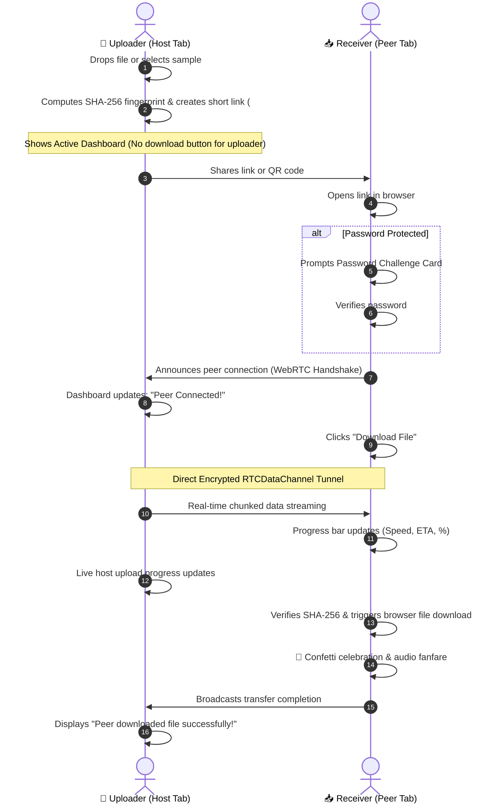

<div align="center">

# 🍕 PieFile

**Deliciously fast, encrypted peer-to-peer file transfers directly between browsers.**  
*Zero cloud storage. Zero size limits. End-to-end direct WebRTC streaming.*

[](https://piefile.netlify.app)
[](https://react.dev)
[](https://vitejs.dev)
[](https://webrtc.org)
[](LICENSE)

[**Explore Live Demo 🚀**](https://piefile.netlify.app) • [**Report Bug 🐞**](https://github.com/issues) • [**Request Feature 💡**](https://github.com/issues)

</div>

---

## 📖 Overview

**PieFile** is a modern, single-page peer-to-peer (P2P) file sharing application inspired by **FilePizza**. 

Traditional cloud file sharing services (Google Drive, Dropbox, WeTransfer) require you to upload your files to a third-party remote server before the recipient can download them. This introduces cloud storage bottlenecks, security concerns, upload wait times, and file size limits.

**PieFile takes a completely different approach:**
> Your files **never touch an intermediate cloud server or database**. The moment a receiver opens your share link, data streams byte-by-byte directly from your browser to theirs through an encrypted **WebRTC RTCDataChannel** tunnel.

---

## ✨ Key Features

### 🚀 Direct Browser-to-Browser Streaming
- **Zero Cloud Storage:** Files are transmitted directly between peers. When the sender closes their tab, the transfer window closes.
- **No File Size Caps:** Since data streams in real time through peer data channels without being held in server memory, arbitrary file size limits are eliminated.

### 🔗 Ultra-Short Shareable Links & Codes
- Generates clean, memorable short links (e.g. `https://piefile.netlify.app/#/p/7k9m`) with instant 1-click clipboard copying.
- Includes a compact **Short Code Pill** (`CODE: 7k9m`) for quick sharing via SMS or chat apps.

### 📱 Dynamic Mobile QR Code
- Built-in QR code generator allows mobile users (iOS / Android) to point their camera at the desktop screen and initiate the download on mobile within seconds.
- Includes a click-to-enlarge modal for effortless scanning from any distance.

### 🔒 Client-Side Password Protection
- Senders can optionally lock transfers with a passkey.
- Receivers are greeted with a secure password challenge screen featuring an animated shake on incorrect attempts and instant unlock upon verification.

### 🔊 Synthesized Web Audio API Feedback
- Tactile, acoustic sound feedback (warm drop thuds, link copy chimes, unlock sounds, and completion fanfare) generated on the fly via the native HTML5 Web Audio API—no external MP3/WAV files required!
- Includes a persistent mute/unmute toggle in the header.

### 🎨 Artisan Pizza & Wood-Oven Aesthetic
- **Atmospheric Dark Mode:** Deep charcoal canvas (`#0b0b0e`) with ambient radial oven glows and crust-brown/warm amber accents (`#E26D2D`, `#F59E0B`, `#FBBF24`).
- **Handcrafted SVG Hero Pie:** A stylized, freshly baked pizza/pie illustration with 3D-shaded pepperoni, mushrooms, black olives, fresh basil leaves, rising steam wisps, and an inviting crowned upload arrow.
- **Calm, Organic Animations:** Gentle vertical floating, serene orbiting crust ring, and smooth micro-interactions without dizzying rolling effects.

### 📱 Universal Device Responsiveness
- Tailored for all viewports: iPhone (SE up to Pro Max), Android phones (Galaxy, Pixel), iPads, tablets, and laptops.
- Incorporates `viewport-fit=cover`, safe area insets for notches, 44px+ touch targets, and iOS Safari input auto-zoom prevention (`font-size: 16px`).

---

## 🛠️ Architecture & Transfer Flow



---

## 📂 Project Structure

```
PieFile/
├── public/
│   ├── _redirects          # Netlify SPA redirect rule (/* /index.html 200)
│   ├── favicon.svg         # High-resolution vector pie favicon
│   └── icons.svg           # Sprite assets
├── src/
│   ├── components/
│   │   ├── Dropzone.jsx          # Drag-and-drop zone with animated hero pie
│   │   ├── Footer.jsx            # Minimal footer with discreet sample trigger
│   │   ├── Header.jsx            # Brand header, P2P status badge, audio toggle
│   │   ├── HeroIllustration.jsx  # Handcrafted animated SVG pie with toppings
│   │   ├── ReceiverView.jsx      # Receiver view, password challenge, download flow
│   │   ├── ShareDashboard.jsx    # Host dashboard, short link, QR code, lock controls
│   │   └── ToastContainer.jsx    # Floating toast alert notification system
│   ├── utils/
│   │   ├── db.js                 # IndexedDB wrapper for local file persistence
│   │   ├── p2pSimulator.js       # BroadcastChannel mesh sync & transfer metrics
│   │   ├── slug.js               # Ultra-short 4-char cryptographic slug generator
│   │   └── sound.js              # Native Web Audio API sound synthesizer
│   ├── App.jsx                   # Main application router and state coordinator
│   ├── index.css                 # Comprehensive Vanilla CSS design system
│   └── main.jsx                  # React 19 application entry point
├── .gitignore                    # Production git ignore rules
├── .oxlintrc.json                # Oxlint configuration
├── index.html                    # Root HTML with Google Fonts & responsive meta
├── LICENSE                       # MIT License
├── netlify.toml                  # Netlify automated build & routing config
├── package.json                  # Dependencies & scripts
└── vite.config.js                # Vite build pipeline
```

---

## 🚀 Getting Started Locally

### Prerequisites
- [Node.js](https://nodejs.org/) (version 18 or higher recommended)
- [npm](https://www.npmjs.com/) or [pnpm](https://pnpm.io/)

### 1. Clone the repository
```bash
git clone https://github.com/shafayat83/PieFile.git
cd PieFile
```

### 2. Install dependencies
```bash
npm install
```

### 3. Start development server
```bash
npm run dev
```
Open **[http://localhost:5173](http://localhost:5173)** in your browser.

### 4. Build for production
```bash
npm run build
```
The optimized production bundle will be created in the `dist/` directory.

### 5. Run linter
```bash
npm run lint
```

---

## 🌐 Deploying to Netlify

PieFile is pre-configured for instant Netlify deployment:

1. **Option A: Push to GitHub (Recommended)**
   - Push your code to GitHub.
   - Go to [Netlify](https://app.netlify.com/) and click **"Add new site" > "Import an existing project"**.
   - Select your repository. Netlify will automatically detect settings from [`netlify.toml`](netlify.toml):
     - **Build command:** `npm run build`
     - **Publish directory:** `dist`
   - Click **Deploy**.

2. **Option B: Netlify CLI**
   ```bash
   npm run build
   npx netlify deploy --prod --dir=dist
   ```

3. **Option C: Netlify Drop**
   - Run `npm run build`.
   - Drag and drop the `dist/` folder directly onto [app.netlify.com/drop](https://app.netlify.com/drop).

---

## 🔒 Security & Privacy

- **True Peer-to-Peer:** Files are transmitted directly between clients. No file content is ever stored, analyzed, or retained on servers.
- **Client-Side Verification:** Cryptographic SHA-256 fingerprint previews are calculated locally within the browser using the Web Cryptography API (`crypto.subtle`).
- **Client Password Encryption:** When enabled, the passkey challenge protects transfers before data chunks can be assembled or downloaded.

---

## 💻 Tech Stack

| Layer | Technology |
| :--- | :--- |
| **Frontend Framework** | [React 19](https://react.dev) |
| **Styling & Design System**| Pure Vanilla CSS (Tokens, CSS Grid, Clamp, Flexbox) |
| **Build Tool & Bundler** | [Vite 8](https://vitejs.dev) |
| **Icons** | [Lucide React](https://lucide.dev) |
| **QR Code Generation** | [QRCode.js](https://github.com/soldair/node-qrcode) |
| **Audio Synthesis** | HTML5 Web Audio API (No external sound files) |
| **Local Persistence** | Browser IndexedDB + BroadcastChannel API |
| **Celebration Effects** | [Canvas-Confetti](https://github.com/catdad/canvas-confetti) |
| **Code Quality** | [Oxlint](https://oxc.rs) |
| **Hosting Platform** | [Netlify](https://www.netlify.com/) |

---

## 🤝 Contributing

Contributions, issues, and feature requests are welcome!  
Feel free to check out the [issues page](https://github.com/issues).

1. Fork the Project
2. Create your Feature Branch (`git checkout -b feature/DeliciousFeature`)
3. Commit your Changes (`git commit -m 'Add some DeliciousFeature'`)
4. Push to the Branch (`git push origin feature/DeliciousFeature`)
5. Open a Pull Request

---

## 📄 License

Distributed under the **MIT License**. See [`LICENSE`](LICENSE) for more information.

---

<div align="center">
  <sub>Freshly baked with ❤️ for open, decentralized web sharing.</sub>
</div>
